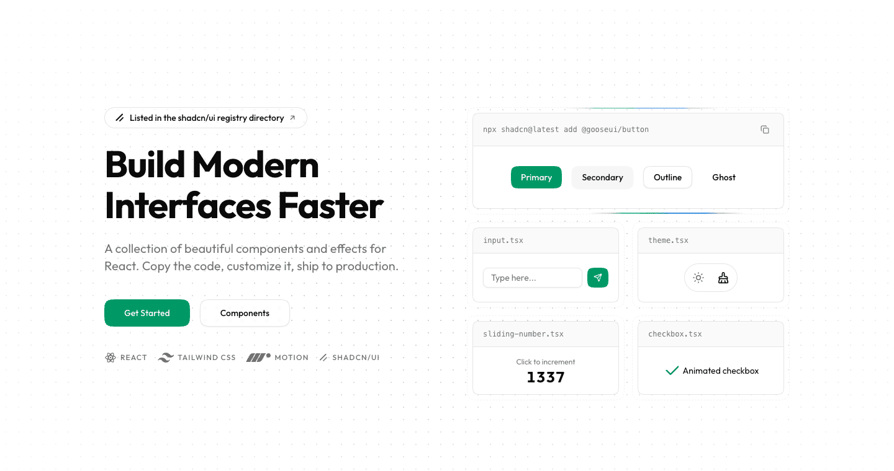

<div align="center">



# GooseUI

**shadcn/ui components that ship as little JavaScript as possible.**

[](LICENSE)
[](https://ui.shadcn.com/docs/directory)
[](https://gooseui.pro)
[](https://github.com/goosen-x/gooseui/stargazers)

[Documentation](https://gooseui.pro/docs) · [Components](https://gooseui.pro/docs/components) · [Русская версия](https://gooseui.pro/ru)

<br>

<a href="https://gooseui.pro">
  <picture>
    <source media="(prefers-color-scheme: dark)" srcset=".github/assets/hero-dark.png">
    
  </picture>
</a>

</div>

<br>

State lives in native HTML (`<details>`, `<dialog>`, `popover`, radio inputs with `:has()`), motion in CSS (scroll-driven animations, View Transitions, `@starting-style`). A component becomes a client component only when there is no way around it, so your pages keep their PageSpeed score.

**94 components, 12 effects and 12 hooks.** Docs in English and Russian.

## Install

GooseUI is an official shadcn registry, so components install with the shadcn CLI:

```bash
npx shadcn@latest add @gooseui/button
```

Prefer another package manager? Use `pnpm dlx`, `yarn dlx` or `bunx --bun` instead of `npx`. The code is copied into your project, there is no package to keep up to date.

## Why GooseUI

| Principle | What it means |
|---|---|
| **Server first** | About 40% of the registry sends no JavaScript at all. The rest loads only the script it needs, and `measure-js` reports the weight of every item. |
| **No runtime dependencies** | Only `react` and `cn`. No Radix, no Motion, no icon packages: icons are inline SVG. |
| **Baseline** | Core behaviour relies on Baseline features. Newer CSS (anchor positioning, `interestfor`, `corner-shape`) is a progressive enhancement with a fallback. Every docs page shows a support table and checks your browser. |
| **Works without JavaScript** | Accordion, tabs, switch, hint, skeletons, marquee and the language switcher keep working with JavaScript disabled. |
| **Theme tokens** | Colors come from shadcn CSS variables, so dark mode and the theme customizer apply to everything. |
| **Accessible** | Keyboard support, focus rings, ARIA states and `prefers-reduced-motion` in every animated item. |

## What's inside

Every name links to its docs page with a live demo.

### Components

| Group | Items |
|-------|-------|
| Inputs | [Booking Calendar](https://gooseui.pro/docs/components/booking-calendar), [Button](https://gooseui.pro/docs/components/button), [Checkbox](https://gooseui.pro/docs/components/checkbox), [Combobox](https://gooseui.pro/docs/components/combobox), [Dropzone](https://gooseui.pro/docs/components/dropzone), [Floating Label Input](https://gooseui.pro/docs/components/floating-label-input), [Input](https://gooseui.pro/docs/components/input), [Option Picker](https://gooseui.pro/docs/components/option-picker), [OTP Input](https://gooseui.pro/docs/components/otp-input), [Phone Input](https://gooseui.pro/docs/components/phone-input), [Prompt Input](https://gooseui.pro/docs/components/prompt-input), [Quantity Slider](https://gooseui.pro/docs/components/quantity-slider), [Radio](https://gooseui.pro/docs/components/radio), [Range Slider](https://gooseui.pro/docs/components/range-slider), [Rating](https://gooseui.pro/docs/components/rating), [Rotary Dial](https://gooseui.pro/docs/components/rotary-dial), [Search Panel](https://gooseui.pro/docs/components/search-panel), [Searchbar](https://gooseui.pro/docs/components/searchbar), [Select](https://gooseui.pro/docs/components/select), [Signature Pad](https://gooseui.pro/docs/components/signature-pad), [Slider](https://gooseui.pro/docs/components/slider), [Step Wizard](https://gooseui.pro/docs/components/step-wizard), [Switch](https://gooseui.pro/docs/components/switch), [Tag Input](https://gooseui.pro/docs/components/tag-input), [Toggle](https://gooseui.pro/docs/components/toggle), [Toggle Group](https://gooseui.pro/docs/components/toggle-group) |
| Display | [Animated Timer](https://gooseui.pro/docs/components/animated-timer), [Avatar Group](https://gooseui.pro/docs/components/avatar-group), [Badge](https://gooseui.pro/docs/components/badge), [Baseline Status](https://gooseui.pro/docs/components/baseline-status), [Copy Field](https://gooseui.pro/docs/components/copy-field), [Corner Badge](https://gooseui.pro/docs/components/corner-badge), [Details Accordion](https://gooseui.pro/docs/components/details-accordion), [Digital Clock](https://gooseui.pro/docs/components/digital-clock), [Kbd](https://gooseui.pro/docs/components/kbd), [Rating Breakdown](https://gooseui.pro/docs/components/rating-breakdown), [Relative Time](https://gooseui.pro/docs/components/relative-time), [Scroll Progress](https://gooseui.pro/docs/components/scroll-progress), [Stacking Cards](https://gooseui.pro/docs/components/stacking-cards), [Timeline](https://gooseui.pro/docs/components/timeline), [Typography](https://gooseui.pro/docs/components/typography) |
| Data | [Activity Heatmap](https://gooseui.pro/docs/components/activity-heatmap), [Gantt Chart](https://gooseui.pro/docs/components/gantt-chart), [Gauge](https://gooseui.pro/docs/components/gauge), [Radar Chart](https://gooseui.pro/docs/components/radar-chart), [Sliding Number](https://gooseui.pro/docs/components/sliding-number), [Stat Counter](https://gooseui.pro/docs/components/stat-counter) |
| Media | [Carousel](https://gooseui.pro/docs/components/carousel), [Compare Slider](https://gooseui.pro/docs/components/compare-slider), [Hover Scroll Screenshot](https://gooseui.pro/docs/components/hover-scroll-screenshot), [Image Viewer](https://gooseui.pro/docs/components/image-viewer), [Silhouette Reveal](https://gooseui.pro/docs/components/silhouette-reveal), [Video Dialog](https://gooseui.pro/docs/components/video-dialog), [Video Hover Preview](https://gooseui.pro/docs/components/video-hover-preview), [Video Synced Steps](https://gooseui.pro/docs/components/video-synced-steps) |
| Feedback | [Cookie Consent](https://gooseui.pro/docs/components/cookie-consent), [Notification Prompt](https://gooseui.pro/docs/components/notification-prompt), [Paint Roller Loader](https://gooseui.pro/docs/components/paint-roller-loader), [Progress Ring](https://gooseui.pro/docs/components/progress-ring), [Ripple Loader](https://gooseui.pro/docs/components/ripple-loader), [Skeleton](https://gooseui.pro/docs/components/skeleton), [Step Progress](https://gooseui.pro/docs/components/step-progress), [Toast](https://gooseui.pro/docs/components/toast) |
| Navigation | [Breadcrumb](https://gooseui.pro/docs/components/breadcrumb), [Burger Button](https://gooseui.pro/docs/components/burger-button), [Language Switcher](https://gooseui.pro/docs/components/language-switcher), [Scroll To Top](https://gooseui.pro/docs/components/scroll-to-top), [ScrollSpy](https://gooseui.pro/docs/components/scroll-spy), [Table of Contents](https://gooseui.pro/docs/components/toc-scrollspy), [Tabs](https://gooseui.pro/docs/components/tabs) |
| Overlay | [Context Menu](https://gooseui.pro/docs/components/context-menu), [Dialog](https://gooseui.pro/docs/components/dialog), [Dropdown Menu](https://gooseui.pro/docs/components/dropdown-menu), [Hint](https://gooseui.pro/docs/components/hint), [Morphing Dialog](https://gooseui.pro/docs/components/morphing-dialog), [Responsive Hint](https://gooseui.pro/docs/components/responsive-hint), [Sheet](https://gooseui.pro/docs/components/sheet), [Tooltip](https://gooseui.pro/docs/components/tooltip) |
| Layout | [Adaptive Grid](https://gooseui.pro/docs/components/adaptive-grid), [Card](https://gooseui.pro/docs/components/card), [Collapsible](https://gooseui.pro/docs/components/collapsible), [Fade Scroller](https://gooseui.pro/docs/components/fade-scroller), [Masonry Grid](https://gooseui.pro/docs/components/masonry-grid), [Scroll Container](https://gooseui.pro/docs/components/scroll-container), [Separator](https://gooseui.pro/docs/components/separator) |
| Marketing | [Marquee](https://gooseui.pro/docs/components/marquee), [Promo Banner](https://gooseui.pro/docs/components/promo-banner), [Testimonial Rotator](https://gooseui.pro/docs/components/testimonial-rotator) |
| Utilities | [Add to Calendar](https://gooseui.pro/docs/components/add-to-calendar), [Copy Button](https://gooseui.pro/docs/components/copy-button), [Install Command](https://gooseui.pro/docs/components/install-command), [Share Buttons](https://gooseui.pro/docs/components/share-buttons), [Theme Customizer](https://gooseui.pro/docs/components/theme-customizer), [Theme Toggle](https://gooseui.pro/docs/components/theme-toggle) |

### Effects

| Group | Items |
|-------|-------|
| Text | [Glitch Text](https://gooseui.pro/docs/effects/glitch-text), [Highlight Text](https://gooseui.pro/docs/effects/highlight-text), [Rotating Text](https://gooseui.pro/docs/effects/rotating-text) |
| Scroll | [Reveal on Scroll](https://gooseui.pro/docs/effects/reveal-on-scroll), [Scroll Word Reveal](https://gooseui.pro/docs/effects/scroll-word-reveal) |
| Decor | [Border Beam](https://gooseui.pro/docs/effects/border-beam), [Dashed Line](https://gooseui.pro/docs/effects/dashed-line), [Dither Background](https://gooseui.pro/docs/effects/dither-background), [Mesh Gradient](https://gooseui.pro/docs/effects/mesh-gradient) |
| Interaction | [Click Sparks](https://gooseui.pro/docs/effects/click-sparks), [Confetti](https://gooseui.pro/docs/effects/confetti), [Theme Transition](https://gooseui.pro/docs/effects/theme-transition) |

### Hooks

[useCopyToClipboard](https://gooseui.pro/docs/hooks/use-copy-to-clipboard), [useDeferredInteraction](https://gooseui.pro/docs/hooks/use-deferred-interaction), [useFileDrop](https://gooseui.pro/docs/hooks/use-file-drop), [useHorizontalWheel](https://gooseui.pro/docs/hooks/use-horizontal-wheel), [useKeyboardFit](https://gooseui.pro/docs/hooks/use-keyboard-fit), [useKeyboardLayout](https://gooseui.pro/docs/hooks/use-keyboard-layout), [useNearViewport](https://gooseui.pro/docs/hooks/use-near-viewport), [useNotificationPermission](https://gooseui.pro/docs/hooks/use-notification-permission), [useNow](https://gooseui.pro/docs/hooks/use-now), [useScrollSpy](https://gooseui.pro/docs/hooks/use-scroll-spy), [useScrollThreshold](https://gooseui.pro/docs/hooks/use-scroll-threshold), [useSoundEffects](https://gooseui.pro/docs/hooks/use-sound-effects)

Browse everything at [gooseui.pro/docs](https://gooseui.pro/docs).

## Development

```bash
pnpm install
pnpm dev               # docs site on localhost:3000
pnpm registry:build    # build public/r/*.json for the shadcn CLI
pnpm typecheck
pnpm lint              # biome
node scripts/measure-js.mjs   # client JS weight of every registry item
```

Registry sources live in `registry/gooseui/{ui,effects,hooks,lib,blocks}`, docs pages in `app/[locale]/(docs)/docs`.

Built with Next.js 16, React 19, Tailwind CSS v4, next-intl and Biome.

## Contributing

Bug reports and pull requests are welcome. For a new component, follow the checklist in [`CLAUDE.md`](CLAUDE.md): registry item, docs page in English and Russian, navigation entry and a card preview. Open an issue first if the change is large.

## License

[MIT](LICENSE)
